# GeM Tender Intelligence Platform

> Automatically discover, extract, score and explore government tenders from the **Government e-Marketplace (GeM) BidPlus** portal, using Playwright, a **local LLM** (Qwen via llama.cpp) and a Flask dashboard.


Built during an internship at **EarthSense Labs** to cut down the manual effort of reviewing hundreds of GeM tenders and to surface the ones that match the company's capabilities.

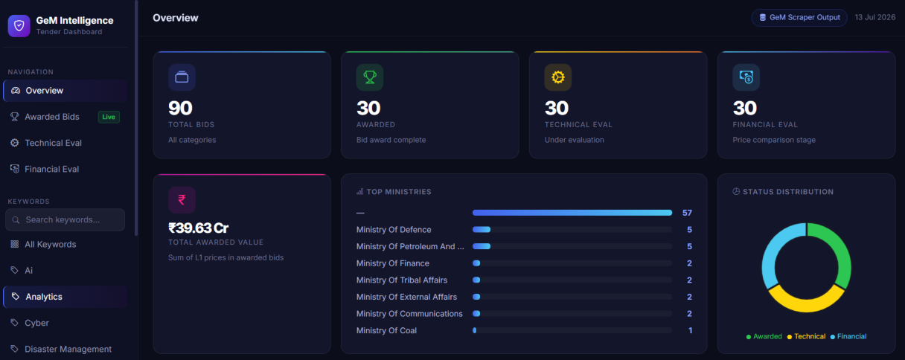

---

## Table of Contents

- [Problem](#problem)
- [What It Does](#what-it-does)
- [Architecture](#architecture)
- [Screenshots](#screenshots)
- [Installation](#installation)
- [Usage](#usage)
- [Relevance Scoring](#relevance-scoring)
- [Output Structure](#output-structure)
- [Project Structure](#project-structure)
- [Tech Stack](#tech-stack)
- [Challenges and Design Decisions](#challenges-and-design-decisions)
- [Future Enhancements](#future-enhancements)

---

## Problem

GeM publishes a large number of tenders that change constantly. Opening each bid page, reading the requirements and deciding whether it fits the company is slow, and relevant opportunities are easy to miss. Plain keyword matching is not enough either, because a tender can mention "AI" or "surveillance" without being a real fit.

## What It Does

| Stage | Component | Description |
|-------|-----------|-------------|
| 1. Discover | `scraper/` + `main.py` | Playwright searches GeM by keyword, applies filters, paginates and opens each bid page |
| 2. Extract | `scraper/html_parser.py` | Classifies pages (detail vs listing), then converts bid HTML into validated JSON |
| 3. Organise | `results/` | Separate Awarded, Technical Evaluation and Financial Evaluation datasets per keyword |
| 4. Score | `score_bids.py` | Local Qwen model compares each tender with `company_profile.json` and returns a score, matches, gaps and a recommendation |
| 5. Explore | `dashboard/` | Flask dashboard with search, filters, relevance ranking, bid details and charts |

Because scoring runs locally through llama.cpp, no tender data is sent to third-party AI services and it works offline.

## Architecture

```text
GeM BidPlus
     ↓
Playwright Scraper (scraper/)
     ↓
HTML page classification + validation
     ↓
Structured JSON (results/)
     ↓
Local LLM Relevance Engine (score_bids.py, Qwen + llama.cpp)
     ↓
Enriched Bid Intelligence
     ↓
Flask Dashboard (dashboard/)
```

<p align="center">
  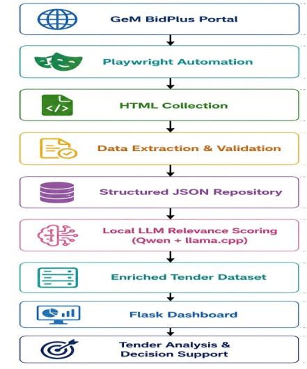
</p>

## Screenshots

### Dashboard overview
Total bids, awarded / technical / financial counts, top ministries, status distribution and total awarded value.


### Search, filters and relevance ranking
Filter by ministry, department and relevance class (Pursue / Relevant / Consider / Skip), search bids, and sort any column.

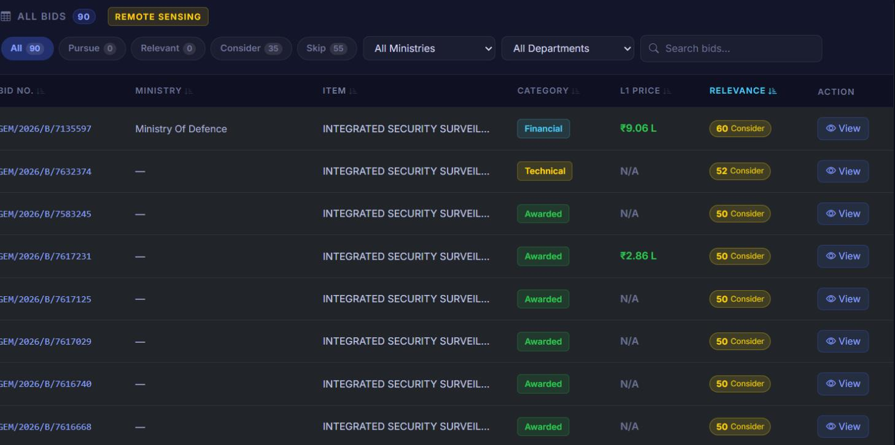

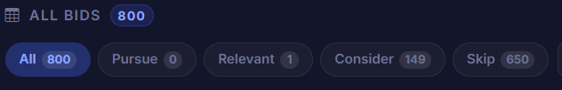

### AI relevance intelligence
For each bid: relevance score, matching capabilities, missing capabilities and a recommendation, all generated by the local LLM.

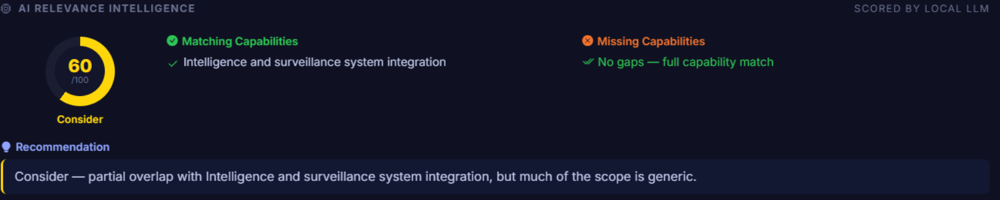

### Bid details
Buyer details, ministry, timeline, item description and L1 award information in one modal.

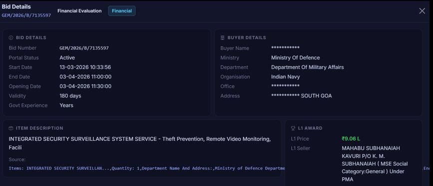

### Technical and financial evaluation

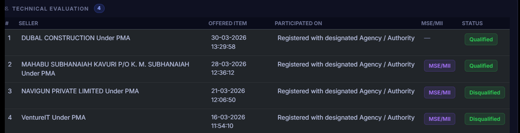

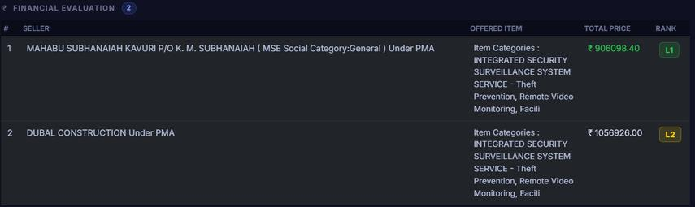

### Vendor analytics
Top winning (L1) vendors across the extracted bids.

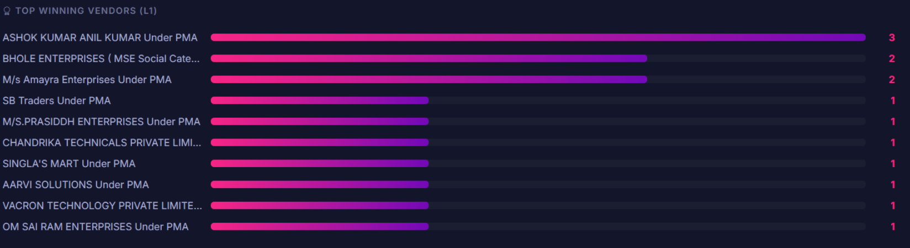

### Scraper pipeline

<p align="center">
  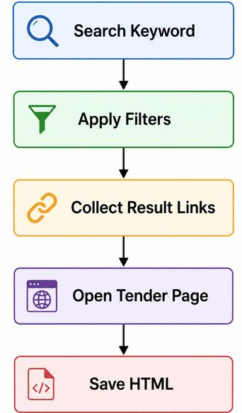
  &nbsp;&nbsp;
  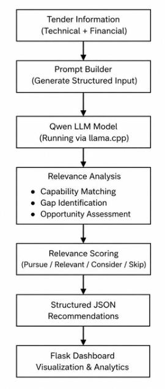
</p>

### Example of extracted JSON

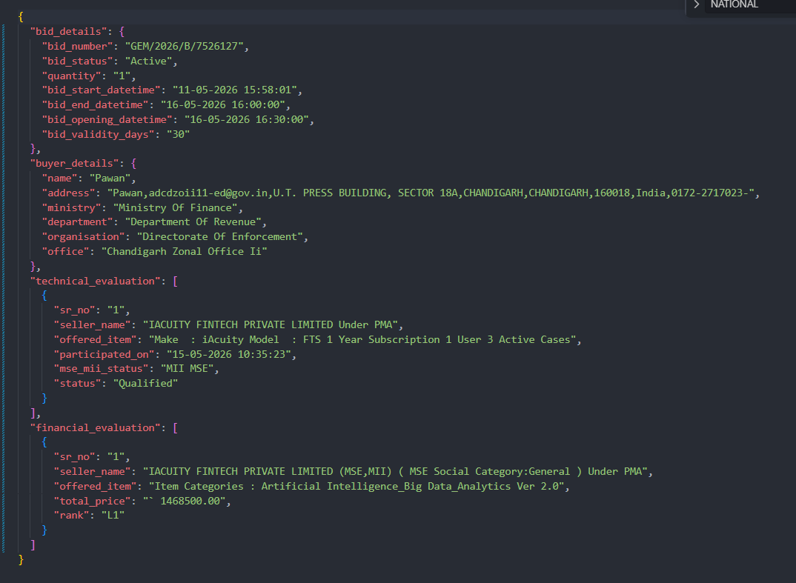

---

## Installation

```bash
git clone https://github.com/nitya-mishraa/playwright-automation.git
cd playwright-automation

python -m venv .venv
# Windows
.venv\Scripts\activate
# macOS / Linux
source .venv/bin/activate

pip install -r requirements.txt
playwright install chromium
```

### Local LLM setup (for relevance scoring only)

1. Build or install [llama.cpp](https://github.com/ggerganov/llama.cpp).
2. Download a Qwen model in GGUF format.
3. Start the model with llama.cpp so `score_bids.py` can reach it. *(Add the exact command, model file name and port you used here.)*

The scraper and dashboard work without this step. Only scoring needs the model.

## Usage

### 1. Scrape tenders

```bash
python main.py -k AI                  # one keyword
python main.py -k Intelligence -p 0   # p = 0 means unlimited pages
```

Keywords used so far: `AI`, `Analytics`, `Cyber`, `Disaster_Management`, `Drone`, `Floods`, `GIS`, `Intelligence`, `Remote_Sensing`, `Satellite`, `Surveillance`.

### 2. Score relevance

```bash
python score_bids.py --keyword AI
```

### 3. Run the dashboard

```bash
cd dashboard
python app.py
```

Open <http://localhost:5000>. On Windows you can also use `run.bat`.

---

## Relevance Scoring

Each tender is compared with the capabilities in `company_profile.json`. The model receives the company profile plus the tender title, description, technical requirements and category, and returns structured JSON.

| Score | Category | Meaning |
|-------|----------|---------|
| 85-100 | **Pursue** | Strong match, worth bidding |
| 70-84 | **Relevant** | Good overlap |
| 40-69 | **Consider** | Partial overlap, review manually |
| 0-39 | **Skip** | Not a fit |

Fields added to every scored bid:

- `relevance_score`
- `matching_capabilities`
- `missing_capabilities`
- `recommendation`

## Output Structure

```text
results/
├── AI/
│   ├── awarded_summary.json
│   ├── technical_summary.json
│   └── financial_summary.json
├── Cyber/
├── Drone/
├── Floods/
└── ...one folder per keyword
```

## Project Structure

```text
playwright-automation/
├── main.py                 # Scraper entry point (thin CLI wrapper)
├── score_bids.py           # Relevance scoring CLI (local LLM)
├── company_profile.json    # Company capability profile used for scoring
├── requirements.txt        # Dependencies for scraper + scorer + dashboard
├── scraper/
│   ├── config.py           # Config dataclass, defaults, CLI args
│   ├── browser_scripts.py  # In-page JS used via page.evaluate
│   ├── html_parser.py      # HTML → structured bid data
│   └── pipeline.py         # Search, pagination, scraping, orchestration
├── dashboard/
│   ├── app.py              # Routes and API endpoints
│   ├── data_loader.py      # Loads and merges bid JSON from results/
│   ├── formatters.py       # Currency formatting, sorting, vendor ranking
│   ├── templates/
│   └── static/
├── docs/screenshots/       # Images used in this README
└── results/                # Scraped + scored data, one folder per keyword
```

## Tech Stack

Python · Playwright · BeautifulSoup · Flask · Bootstrap · Chart.js · JSON · Qwen (GGUF) · llama.cpp · Git/GitHub

## Challenges and Design Decisions

- **Listing vs detail pages:** screenshots and manual HTML inspection did not scale, so a lightweight HTML-content classifier decides whether a page is worth extracting.
- **Dynamic content:** Playwright waits for elements to load, and validation checks confirm data exists before parsing.
- **Embedded data:** custom parsing pulls tender data out of page content into a fixed JSON schema.
- **Relevance:** keyword matching alone was too noisy, so an LLM compares each tender with the company profile for context-aware scoring.
- **Local over cloud:** running Qwen through llama.cpp keeps procurement data private and removes API dependence.
- **Maintainability:** the code was refactored into separate scraper, scoring and dashboard modules with logging and error handling.

## Future Enhancements

- Natural-language tender search
- Semantic bid retrieval with embeddings
- Local-LLM-based pre-filtering before scraping detail pages
- Advanced analytics and reporting
- Scheduled scraping and alerts for new "Pursue" tenders

---

## Author

Built by **Nandani Tripathi** (B.Tech CSE, Cyber Security and Digital Forensics, VIT Bhopal) during an LLM Intern – Tender Analysis internship at EarthSense Labs, May–July 2026.
